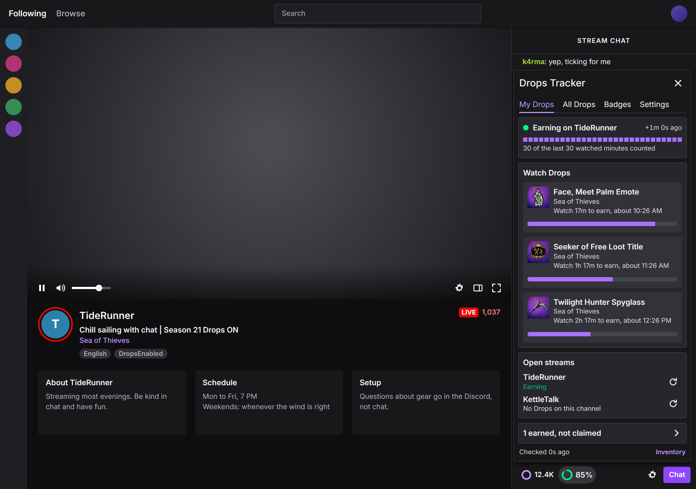
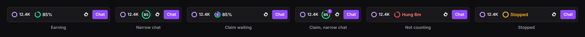
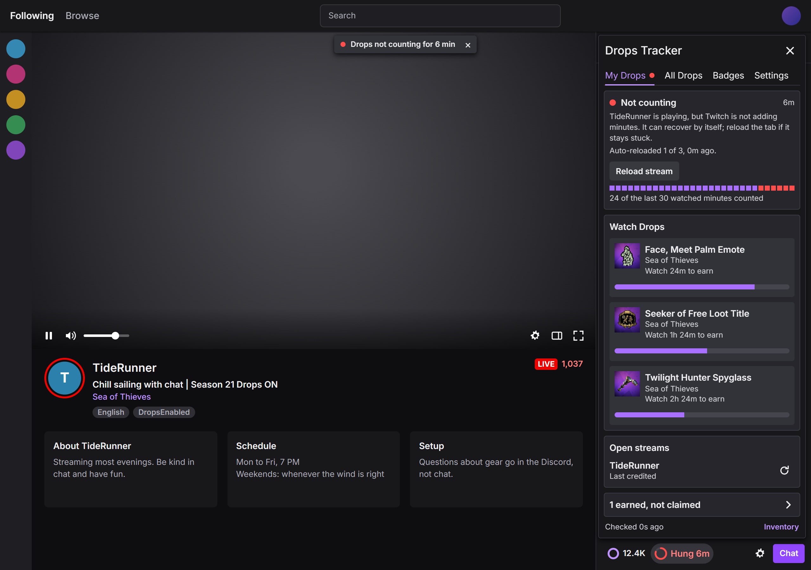
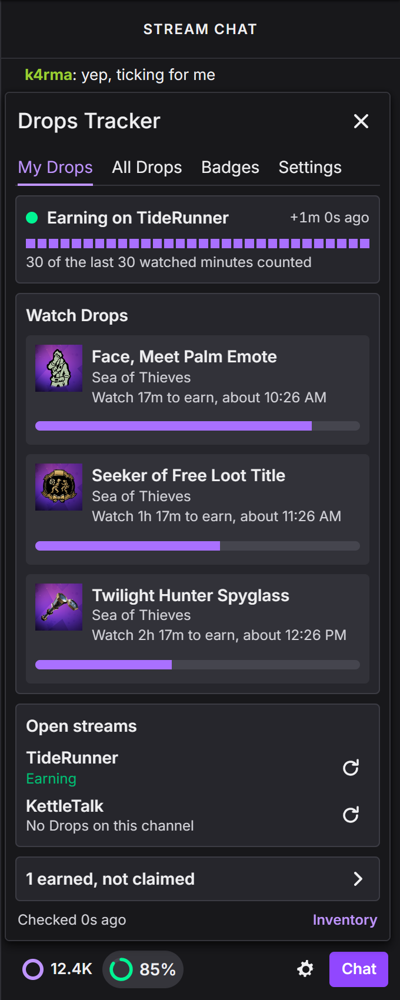
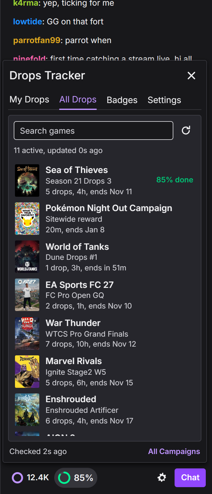
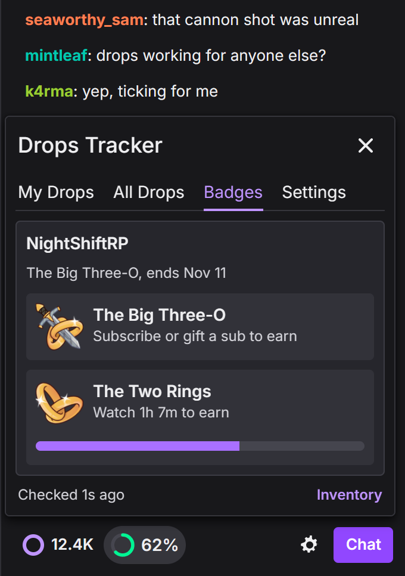
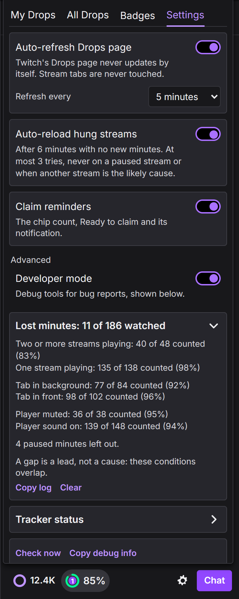

# Drops Tracker

A Chromium (MV3) extension that tells you whether Twitch is really adding Drops watch-minutes right now, and warns you when it is not.

Twitch's own progress bars only update when the page loads, and watch-time sometimes stops being credited while the stream keeps playing fine. This extension asks Twitch's server once a minute instead of trusting the page, and treats rising minutes as the only proof of earning.

It is read-only. It never claims a drop, never simulates watching, and never opens a stream itself.



> Unofficial. It uses the same private GraphQL operations as twitch.tv, which can change without notice. Not affiliated with Twitch.

## Contents
- [Install](#install) ([Chrome Web Store](https://chromewebstore.google.com/detail/drops-tracker/ijgmbcfeemlooekeibhgimikgmejohlh))
- [What you see](#what-you-see)
- [How it works](#how-it-works)
- [Project layout](#project-layout)
- [Development](#development)
- [Privacy](#privacy)
- [Reference: measured Twitch behaviour](docs/twitch-drops-facts.md)

## Install
**[Get it on the Chrome Web Store](https://chromewebstore.google.com/detail/drops-tracker/ijgmbcfeemlooekeibhgimikgmejohlh).** It works in Chrome, Brave, Edge and other Chromium browsers, and updates itself.

It uses the Twitch login already in that browser.

### From source
1. Clone this repo.
2. Open `chrome://extensions` (or `brave://extensions`, `edge://extensions`).
3. Turn on **Developer mode**.
4. Click **Load unpacked** and pick the `extension/` folder.

There is no build step. After changing the code, press **Reload** on the extension's card; open Twitch tabs pick up the new version without a refresh. Remove the store copy first, or both will run.

## What you see

**Chip in the chat row**, beside your channel points: a progress ring with `82%`, `Hung 5m`, `Stopped`, `Claim` or `Drops ?`. Green is earning, amber needs attention or is slow, red is not counting, purple has just started. In a narrow chat column the label hides and the percentage moves inside the ring. A purple count shows how many earned drops from running campaigns wait to be claimed: inside the ring beside the label, or on the ring's corner in a narrow chat. It never changes the ring's colour.



**Toolbar badge:**

| Badge | Meaning |
|---|---|
| `81%` green | Minutes are rising |
| `...` blue | Stream just opened, waiting for the first minute |
| `HUNG` red | A stream that can earn is open, but no minutes are being added |
| `STOP` amber | You were earning and now no open stream can (game change, offline, raid) |
| `51%` amber | Earning slowly, or the minutes are going to a drop already earned or one that cannot finish in time |
| `CLM` purple | A drop is ready to claim, and nothing is being earned. While earning, a waiting claim does not change the badge |
| `?` amber | Open streams cannot be checked, so tracking is unknown |
| `ERR` / `OFF` grey | Cannot read Twitch / signed out. Progress is unknown, not stalled |

**Warnings:** one system notification and a small dismissible pill on Twitch pages, including in fullscreen. Nothing appears while things are healthy.



**Panel**, from the chip or the toolbar icon, laid out like Twitch's own Drops panel:

- **My Drops**: the verdict, a 30-minute credit strip, the drops you can earn where you are, each open stream's state with a reload button, and earned rewards you have not claimed. On a channel with no drops it shows what another open tab can earn, headed `Watch Drops on <channel>`, or nothing.
- **All Drops**: every campaign running on Twitch, yours first, with search. Twitch only gives this list to its own campaigns page, so the extension opens that page in a background tab for a moment (no video, so it uses no stream slot) and reads the answer the page receives. Cached for 30 minutes.
- **Badges**: the current channel's sub and watch badge drops. Watch badges are also tracked like any other drop.
- **Settings**: the two helpers below, and **Developer mode**, which shows the debug tools under them: the Lost minutes log, the tracker's current state, **Check now**, and **Copy debug info** for bug reports.

| My Drops | All Drops | Badges |
|---|---|---|
|  |  |  |

**Settings** (Settings tab; both helpers on by default, Developer mode off):

- **Auto-refresh Drops page**: reloads open `twitch.tv/drops/*` tabs every 1, 5, 10 or 30 minutes, since that page never updates itself. Never touches stream tabs.
- **Auto-reload hung streams**: reloads a stream tab after 6 minutes with no new minutes, counted from when that tab could last earn. At most 3 tries per hang, 10 minutes apart. Never on a paused tab, when another playing stream is the likely cause, or when an unclaimed drop may be the cause. Whether a reload actually clears a hang is not yet measured.

**Lost minutes** (Settings tab, with Developer mode on) records each watched minute: whether it was credited, how many streams were playing, tab in background, muted, picture height, playback speed, ad showing. Once both sides of a condition have 10 minutes it compares credit rates. Paused minutes are left out. A gap is a lead, not a cause, since the conditions overlap.



## How it works

```
 every minute (chrome.alarms)
          |
          v
 background.js ----- reads <video> state from open Twitch tabs (chrome.scripting)
          |
          +--------- gql.twitch.tv: Inventory, AvailableDrops, CurrentSession, StreamInfo
          |          (lib/twitch.js, auth-token cookie, persisted queries)
          v
 lib/tracker.js      pure: (previous state, observation, now) -> next state + verdict
          |
          v
 chrome.storage.local
          |
          +--> toolbar badge, notification, warning pill
          +--> content.js: chip in the chat row, panel (lib/panel.js)
          +--> popup.js: same panel from the toolbar
```

The core idea is in `lib/tracker.js`: it keeps the highest minutes seen per drop and calls it earning only when a reading goes up. Everything it can be wrong about has its own verdict:

- **earning**: minutes rose within the last few minutes
- **waiting**: a stream that can earn just opened, so give it time
- **stalled** (Hung): a stream that can earn is open and nothing has risen for 4 minutes (2 if every player is visibly dead), with a diagnosed cause such as paused, frozen, too many streams, or an unclaimed drop
- **idle**: nothing open can earn, or it stopped (`lost`), or cannot be checked (`limited`)
- **error / api_changed / signed_out**: progress is unknown, never reported as stalled

Twitch's persisted query hashes get retired over time. `lib/twitch.js` pins known hashes and `background.js` learns current ones from Twitch's own page traffic, so it usually repairs itself after opening the Drops page once.

Measured facts behind the thresholds, the real failure shapes Twitch returns, and open questions live in [docs/twitch-drops-facts.md](docs/twitch-drops-facts.md), indexed by symptom.

## Project layout

| Path | What it is |
|---|---|
| `extension/manifest.json` | MV3 manifest. Host access is `*.twitch.tv` only |
| `extension/background.js` | Service worker: polling loop, tab reads, storage, badge, notifications, auto-reload, All Drops loading |
| `extension/content.js` | Chip in the chat row and the in-page panel host |
| `extension/popup.html`, `popup.js` | Toolbar popup, using the same panel |
| `extension/page-hook.js`, `page-bridge.js` | Run only on `/drops/campaigns`: read the campaign list Twitch's page receives |
| `extension/panel.css` | Panel styles, built on Twitch's design tokens |
| `extension/lib/tracker.js` | Pure state machine and verdicts. Start here |
| `extension/lib/twitch.js` | Read-only GQL client and response parsing |
| `extension/lib/chip.js` | What the chip says, and which drops show on a channel |
| `extension/lib/panel.js` | Panel UI (all four tabs) |
| `extension/lib/settings.js` | Settings, auto-refresh and auto-reload timing |
| `extension/lib/directory.js`, `badges.js`, `minutelog.js`, `debug.js` | Data shaping for All Drops, Badges, Lost minutes and Debug |
| `tests/*.test.mjs` | Unit tests (`node:test`), run against the real modules |
| `tests/fixtures/` | Captured Twitch responses, with account data removed |
| `scripts/e2e.mjs` | Real-browser test with fake channel pages |
| `scripts/screenshots.mjs` | README screenshots, same setup as the e2e test |
| `docs/twitch-drops-facts.md` | Measured Twitch behaviour, indexed by symptom |

Everything in `extension/lib/` except `panel.js` is pure (no `chrome.*`), so it can be tested in Node.

## Development

Requirements: Node 22+ (the test script uses `node --test` with a glob) and a Chromium browser.

```bash
npm ci
npm run check   # syntax check of every extension file
npm test        # unit tests
npm run e2e     # real-browser test, see below
```

`npm run e2e` launches a throwaway browser profile with the extension loaded and drives it with Playwright: real service worker, cookies, tabs and script injection, with Twitch's API answered by fixtures and channel pages faked. It also mounts the chip on a real `twitch.tv/popout/twitch/chat` page, which has no video. Screenshots go to `scripts/e2e-out/`. It looks for Brave at the default Windows path; set `E2E_BROWSER` to another Chromium executable to use that instead.

`npm run icons` regenerates the toolbar icons. `npm run package` builds the Chrome Web Store upload in `dist/`, and `npm run store-images` makes the store's screenshots and promo tile in `docs/store/`; what to paste into each dashboard field is in [docs/chrome-web-store.md](docs/chrome-web-store.md). `npm run screenshots` regenerates the images in `docs/screenshots/` the same way as the e2e test: the real extension on staged channel pages, with real campaign art from Twitch's CDN.

Before changing behaviour, read [CONTRIBUTING.md](CONTRIBUTING.md). It lists the rules that are easy to break and expensive when broken.

## Privacy
- Talks only to `twitch.tv` and `gql.twitch.tv`. No analytics, no other servers.
- The Twitch `auth-token` cookie is read for each request and never stored, logged or returned.
- Everything it keeps (state, settings, the minute log) stays in `chrome.storage.local` in your browser. **Copy debug info** builds its output from a fixed list of fields, so it holds channels and progress but never your login.

## License
[GPL-3.0](LICENSE). You can use, change and share it; versions you distribute must stay under the GPL.
